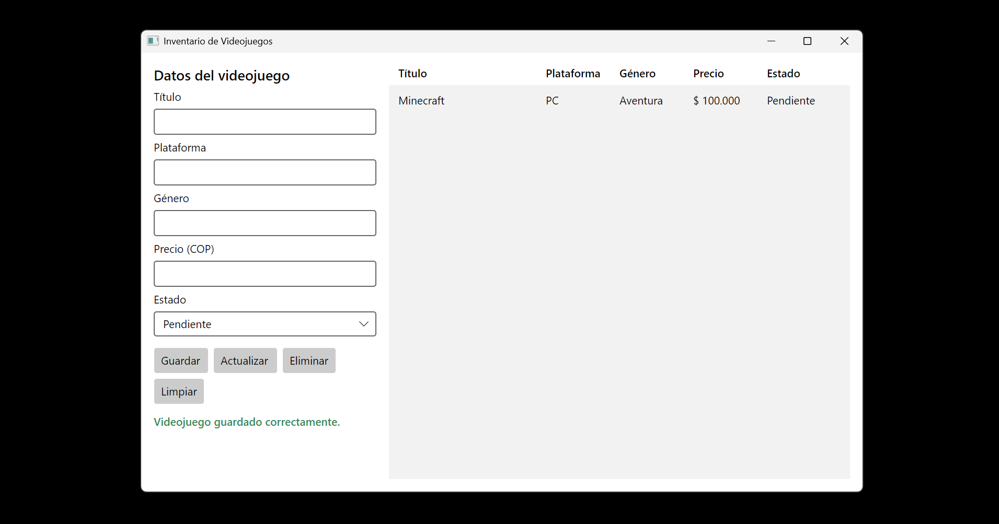
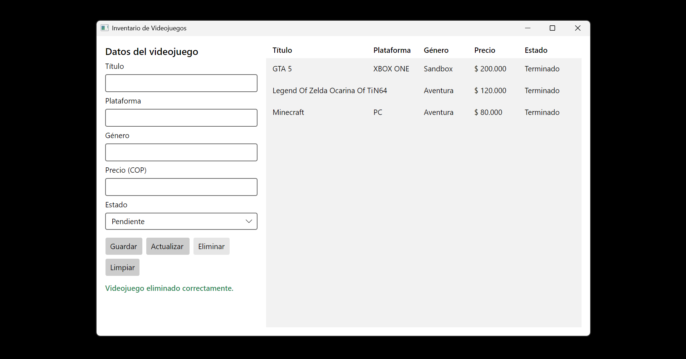
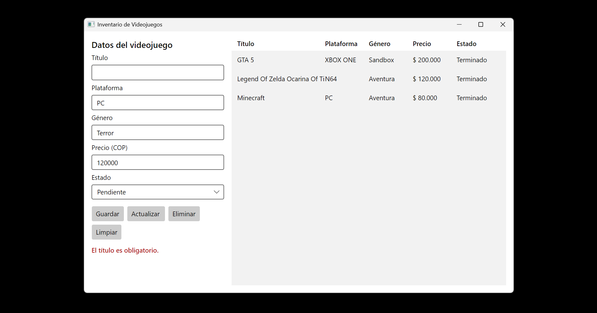

# Inventario de Videojuegos

## 1. Informacion general
- Proyecto: Inventario de Videojuegos
- Estudiante: Juan Camilo González Ospino
- Descripcion: es una aplicacion de escritorio que hice para organizar mi coleccion de videojuegos.
- Problema que resuelve: a veces uno ya no recuerda que juegos tiene, en que plataforma estan, cuanto costaron o si ya los termino. Con esta app todo queda guardado en un solo sitio.
- Objetivo: poner en practica lo visto en el curso, que es POO, Avalonia UI y ADO.NET con SQLite, en una app con CRUD completo.

## 2. Que se puede hacer con la app
- Guardar un videojuego nuevo.
- Ver la lista con todos los videojuegos guardados.
- Actualizar un juego: se selecciona en la lista, se cambian los datos y se presiona Actualizar.
- Eliminar el juego que este seleccionado.
- Limpiar el formulario para empezar de nuevo.

Si se deja un campo vacio o el precio no es un numero, la app muestra un mensaje explicando el error y sigue funcionando normal. El precio se escribe en pesos colombianos.

## 3. Tecnologias utilizadas
- .NET 10 y C#
- Avalonia UI 11.2.3 para la interfaz
- ADO.NET con Microsoft.Data.Sqlite 8.0.11 para hablar con la base de datos
- SQLite como base de datos

## 4. Estructura del proyecto

VideojuegosApp
    Models
        Videojuego.cs
    Data
        BaseDatos.cs
        VideojuegoDAO.cs
        init.sql
    Services
        VideojuegoServicio.cs
    Views
        MainWindow.axaml
        MainWindow.axaml.cs
    App.axaml
    Program.cs
    evidencias

Cada clase tiene un trabajo propio:

- Videojuego: representa un juego con sus datos y se encarga de que sean validos.
- BaseDatos: abre la conexion con SQLite y crea la tabla.
- VideojuegoDAO: ejecuta las consultas SQL para guardar, leer, actualizar y eliminar.
- VideojuegoServicio: revisa lo que escribe el usuario y se lo pasa al DAO.
- MainWindow: es la ventana, recibe los clics y muestra la informacion.

Trabajan en cadena: la ventana le pide cosas al servicio, el servicio al DAO, y el DAO a la base de datos.

La POO se aplica en la clase Videojuego, con objetos, constructor y encapsulamiento, porque tiene atributos privados y propiedades que validan. Tambien se aplica en la separacion del codigo en interfaz, logica y datos, para que cada parte tenga una sola responsabilidad.

## 5. Como instalarla
1. Instalar el SDK de .NET 10 desde https://dotnet.microsoft.com/download/dotnet/10.0
2. Descargar el proyecto con el comando: git clone URL-del-repositorio
3. Entrar a la carpeta que contiene el archivo VideojuegosApp.csproj.
4. Ejecutar el comando dotnet restore para descargar las dependencias.

No hace falta configurar nada mas.

## 6. Como ejecutarla
Desde la carpeta del proyecto se ejecutan estos dos comandos, uno despues del otro:

dotnet restore
dotnet run

Y se abre la ventana de la aplicacion.

## 7. Base de datos
- Que guarda: la informacion de los videojuegos.
- Tabla videojuegos: id, titulo, plataforma, genero, precio y estado.
- Conexion: el metodo BaseDatos.ObtenerConexion abre el archivo videojuegos.db.
- Donde esta el CRUD: en VideojuegoDAO, usando consultas parametrizadas.
- Como se crea: sola. Al abrir la app se ejecuta Data/init.sql, que crea la tabla si todavia no existe, asi que no hay que hacer ningun paso manual.

## 8. Evidencias de funcionamiento

Prueba 1, registro. Agregue un juego y aparecio en la lista.

Prueba 2, consulta. La lista muestra los juegos guardados.

Prueba 3, actualizacion. Cambie un dato y se guardo bien.

Prueba 4, eliminacion. El juego eliminado ya no aparece.

Prueba 5, validacion. Con datos incorrectos salio un mensaje de error y la app no se cerro.

Prueba 6, persistencia. Cerre la app, la abri otra vez y los juegos seguian ahi.

## 9. Problemas encontrados y soluciones
Al ejecutar la app, no encontraba el archivo init.sql. Lo solucione configurandolo en el archivo .csproj para que se copie a la carpeta de salida, y asi BaseDatos puede leerlo.
