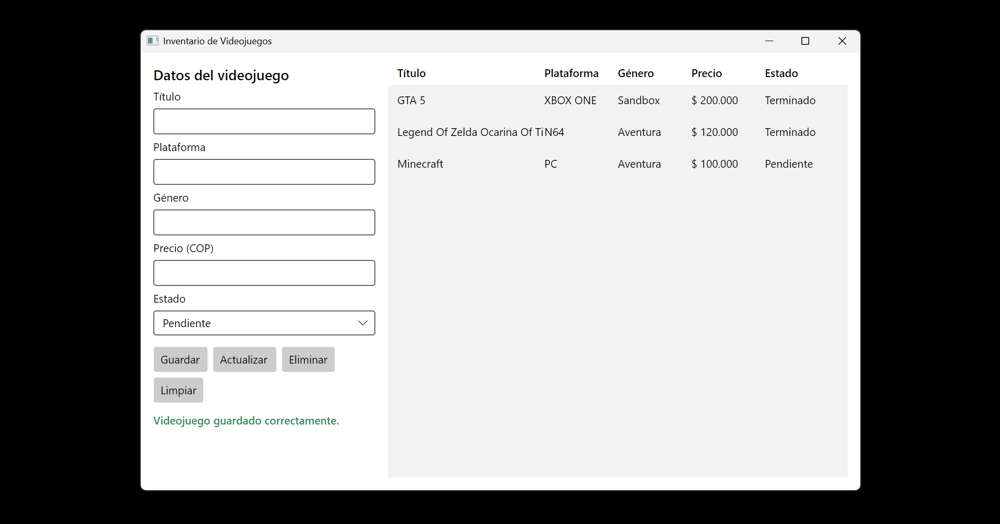
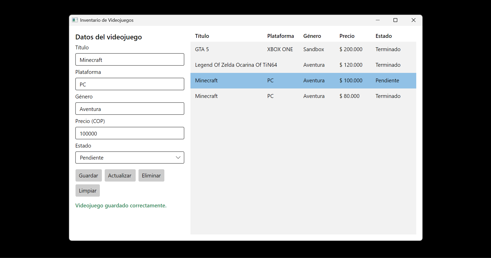
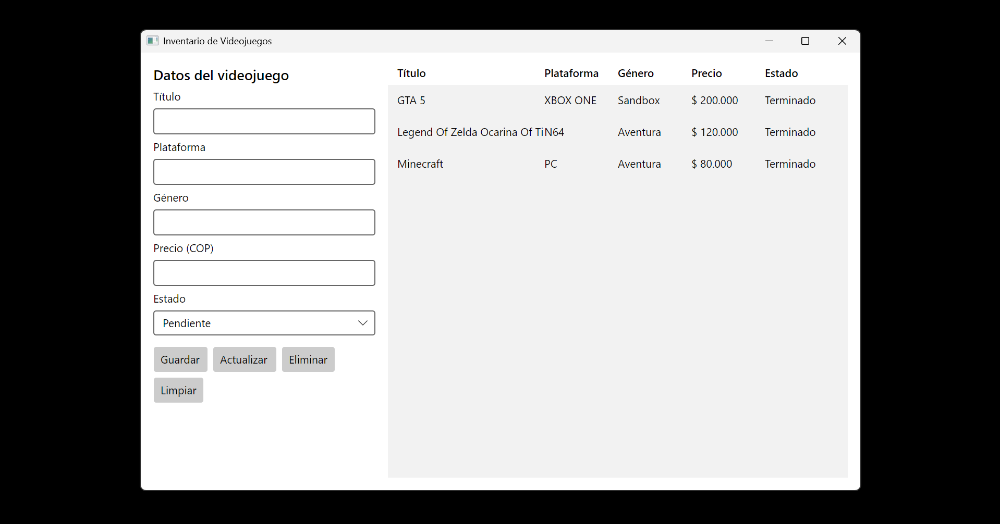

# Inventario de Videojuegos

## 1. Informacion general
- **Proyecto:** Inventario de Videojuegos
- **Estudiante:** Juan Camilo González Ospino
- **Que es?** Una aplicacion de escritorio para llevar el control de mis videojuegos.
- **Que problema resuelve?** Muchas veces no recordamos que juegos tenemos, en que plataforma estan, cuanto costaron o si ya los terminamos. Esta app lo guarda todo en un solo lugar.
- **Objetivo:** practicar POO, Avalonia UI y ADO.NET con SQLite en una app con CRUD completo.

## 2. Que puedo hacer con la app?
- **Guardar** un videojuego nuevo.
- **Ver** la lista de todos los videojuegos guardados.
- **Actualizar** uno: lo selecciono en la lista, cambio los datos y presiono Actualizar.
- **Eliminar** el que tenga seleccionado.
- **Limpiar** el formulario.

Si falta un dato o el precio no es un numero, la app muestra un mensaje de error y sigue funcionando.

## 3. Tecnologias
- .NET 10 (SDK 10.0) y C#
- Avalonia UI 11.2.3
- ADO.NET con Microsoft.Data.Sqlite 8.0.11
- SQLite

## 4. Estructura del proyecto
```
VideojuegosApp/
|-- Models/Videojuego.cs
|-- Data/BaseDatos.cs
|-- Data/VideojuegoDAO.cs
|-- Data/init.sql
|-- Services/VideojuegoServicio.cs
|-- Views/MainWindow.axaml
|-- App.axaml, Program.cs
`-- evidencias/
```

| Clase | Para que sirve |
|---|---|
| `Videojuego` | Guarda los datos de un juego y valida que sean correctos. |
| `BaseDatos` | Abre la conexion con SQLite y crea la tabla. |
| `VideojuegoDAO` | Hace las consultas SQL (guardar, leer, actualizar, eliminar). |
| `VideojuegoServicio` | Revisa los datos que escribe el usuario y le pide al DAO que los guarde. |
| `MainWindow` | La ventana: recibe los clics y muestra la informacion. |

Funcionan en cadena: MainWindow  -> VideojuegoServicio -> VideojuegoDAO -> base de datos.

**POO en el proyecto:** clases y objetos Videojuego, encapsulamiento (atributos privados con propiedades que validan), constructor, y separacion entre interfaz, logica y datos.

## 5. Como instalarla
1. Instalar el SDK de .NET 10: https://dotnet.microsoft.com/download/dotnet/10.0
2. Descargar el proyecto: `git clone <URL-del-repositorio>`
3. Entrar a la carpeta que contiene `VideojuegosApp.csproj`.
4. Ejecutar `dotnet restore`.

No hace falta ninguna configuracion mas.

## 6. Como ejecutarla
Dentro de la carpeta del proyecto:
```
dotnet restore
dotnet run
```

## 7. Base de datos
- **Guarda:** los videojuegos.
- **Tabla `videojuegos`:** id, titulo, plataforma, genero, precio, estado.
- **Conexion:** `BaseDatos.ObtenerConexion()` abre el archivo `videojuegos.db`.
- **CRUD:** esta en `VideojuegoDAO`, con consultas parametrizadas.
- **Creacion:** automatica. Al abrir la app se ejecuta `Data/init.sql`, que crea la tabla si no existe. No hay que hacer nada manual.

## 8. Evidencias

| Prueba | Captura | Resultado |
|---|---|---|
| 1. Registro |  | Agregue un juego y aparecio en la lista. |
| 2. Consulta |  | La lista muestra los juegos guardados. |
| 3. Actualizacion |  | Cambie un dato y se guardo. |
| 4. Eliminacion |  | El juego eliminado ya no aparece. |
| 5. Validacion |  | Con datos incorrectos salio un error y la app siguio abierta. |
| 6. Persistencia |  | Al cerrar y abrir de nuevo, los juegos seguian ahi. |

## 9. Problemas y soluciones

**Problema:** la app no encontraba el archivo `init.sql` al ejecutarse.
**Solucion:** lo marque en el `.csproj` para que se copie a la carpeta de salida y asi `BaseDatos` pueda leerlo.